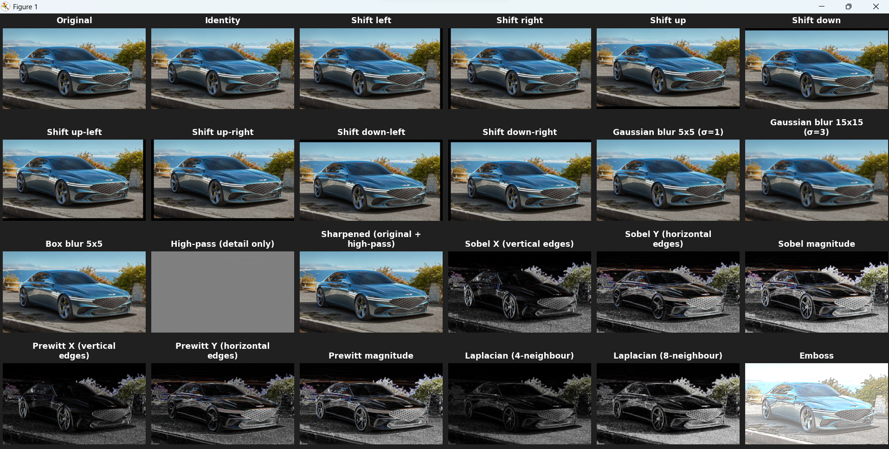

# RGB Image Filters with 2D Convolution

A small Python project that applies classic image-processing filters to a **colour (RGB) image** using 2D convolution, and displays every result side by side in a single Matplotlib window.

Each filter is a small kernel (a matrix of weights) that is slid over every colour channel of the image. Changing the kernel changes the effect: blur, sharpen, shift, detect edges, and more.



## Filters included

| Group | Filters |
|---|---|
| **Basic** | Original, Identity |
| **Shifts** | Left, Right, Up, Down, and the four diagonals (up-left, up-right, down-left, down-right) |
| **Blurs** | Gaussian 5×5, Gaussian 15×15, Box blur 5×5 |
| **Sharpening** | High-pass filter, Sharpened image (original + high-pass) |
| **Edge detection** | Sobel X / Y / magnitude, Prewitt X / Y / magnitude |
| **Second derivative** | Laplacian (4-neighbour), Laplacian (8-neighbour) |
| **Other** | Emboss |

## How it works

- The image is loaded with OpenCV and converted from BGR to **RGB**.
- Transparent PNGs are blended onto a background colour (white by default) so transparent areas don't turn black.
- Every filter is applied to the **R, G and B channels separately** with `scipy.signal.convolve2d` (small kernels) or `scipy.signal.fftconvolve` (large kernels, much faster).
- **Shift filters** use a kernel that is all zeros except for a single `1` away from the centre. Convolution flips the kernel, so the `1` is placed at `centre + (dy, dx)` to move the image `dx` pixels right and `dy` pixels down.
- **Sharpening** uses the high-pass idea: `high-pass = image − blurred image`, and `sharpened = image + high-pass`.
- **Edge detection** computes the horizontal and vertical gradients with Sobel or Prewitt kernels, then combines them as `sqrt(gx² + gy²)`.
- Filters that produce negative values (Sobel, Prewitt, Laplacian) are shown as absolute values. High-pass and Emboss are offset by 128 so negative values appear as grey.

## Requirements

- Python 3.8+
- Matplotlib 3.6+
- NumPy
- SciPy
- OpenCV

Install everything with:

```bash
pip install opencv-python numpy scipy matplotlib
```

## Usage

1. Put your image in the same folder as the script and name it `hello.png` (or change the file name in the script).
2. Run:

```bash
python rgb_filters.py
```

A window opens showing all filtered versions of your image with the filter name above each one.

## Configuration

These values are near the top and bottom of `rgb_filters.py`:

| Setting | Default | What it does |
|---|---|---|
| `BACKGROUND` | `(255, 255, 255)` | Colour placed behind transparent areas of a PNG |
| `S` | `25` | Shift distance in pixels |
| `FIG_BG` | `"#202020"` | Window background colour |
| `TITLE_COLOR` | `"white"` | Colour of the filter names |
| `figsize` | `(18, 10)` | Window size in inches. Lower it if the window is too big for your screen |

## Project structure

```
.
├── rgb_filters.py   # the script
├── hello.png        # your input image
├── preview.png      # screenshot used in this README
└── README.md
```

## Ideas to extend it

- Add more kernels (Scharr, Roberts, unsharp masking, motion blur).
- Add a command-line argument for the input image path.
- Save each filtered image to disk.
- Compare against OpenCV's built-in functions (`cv2.GaussianBlur`, `cv2.Sobel`, `cv2.Laplacian`).

## License

MIT. Use it however you like.